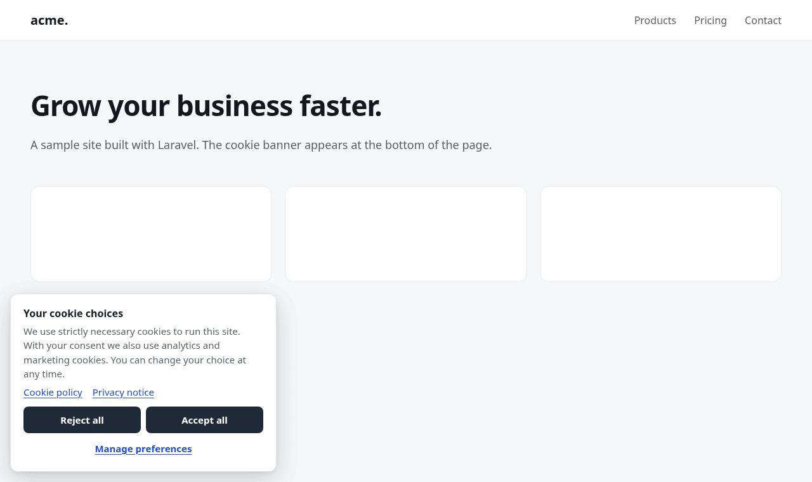
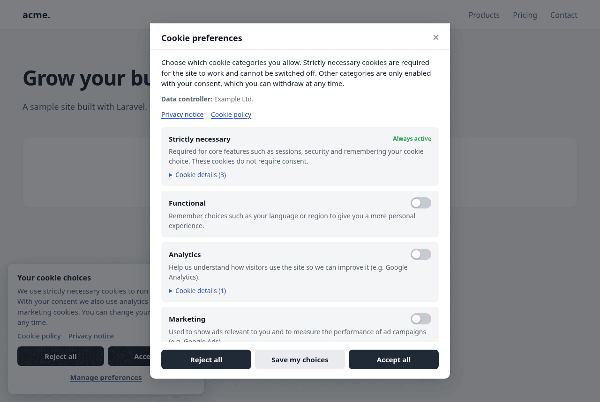
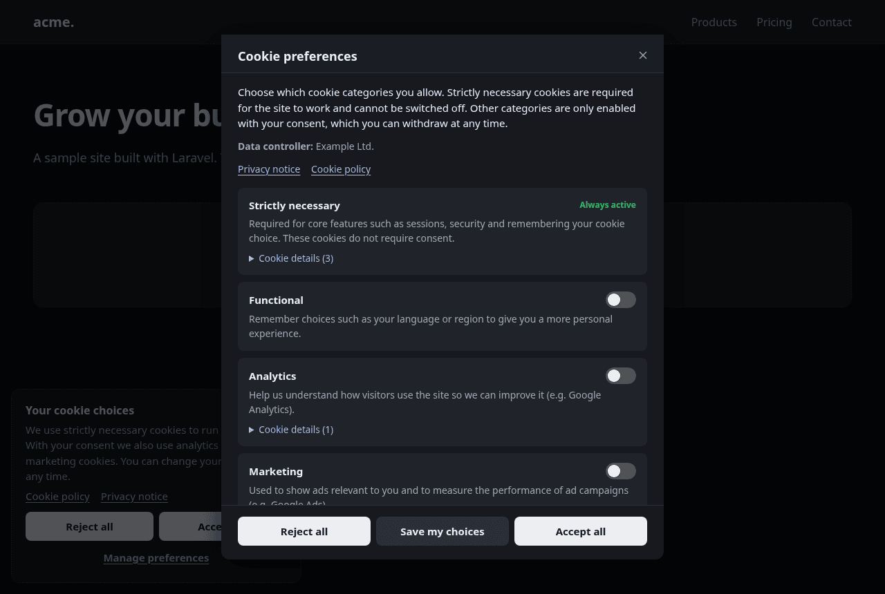
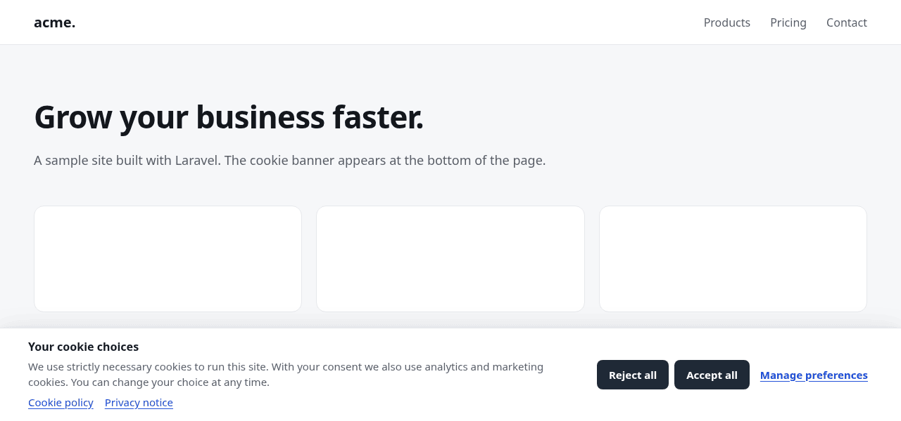
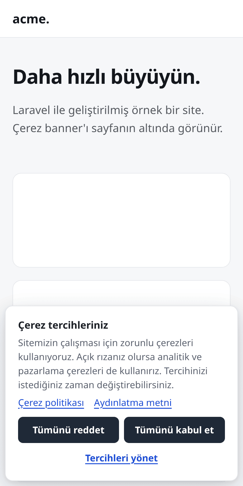
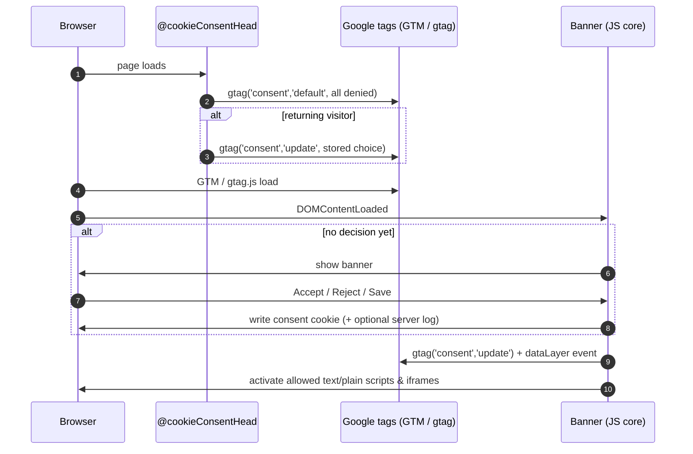

<div align="center">

# 🍪 Webmarka Cookie Consent

**Cookie consent for Laravel 13+ with Google Consent Mode v2 and KVKK / GDPR compliant defaults.**

No dependencies, no Node.js on your server. Works with Blade, Livewire, Inertia, Alpine.js and Tailwind CSS.

[](https://github.com/hakanispirli/webmarka-cookie-consent/actions/workflows/tests.yml)
[](https://packagist.org/packages/webmarka/cookie-consent)
[](https://packagist.org/packages/webmarka/cookie-consent)
[](composer.json)
[](https://laravel.com)
[](LICENSE)

[**Installation**](#-installation) · [**AI setup**](#-install-with-an-ai-assistant) · [**Consent Mode v2**](#-google-consent-mode-v2) · [**KVKK / GDPR**](#%EF%B8%8F-kvkk--gdpr-checklist) · [**Türkçe**](README.tr.md)

<br>



</div>

---

## ✨ Features

<table>
<tr>
<td width="50%" valign="top">

### 🎯 Google Consent Mode v2
- `ad_user_data` and `ad_personalization` support
- Defaults set **before** Google tags run, and a returning visitor's choice is restored synchronously (no lost page views)
- **Advanced** and **basic** modes, plus region-specific defaults
- `dataLayer` event for GTM triggers
- Optionally prints GTM / gtag.js in the correct order

</td>
<td width="50%" valign="top">

### ⚖️ KVKK / GDPR compliant defaults
- **"Reject all" is as prominent as "Accept all"**
- No pre-ticked boxes, and closing the banner is not consent
- A short banner first, then a preference center with choices per category
- Easy withdrawal; the matching cookies are deleted
- Shows the data controller, purposes, retention and **transfers abroad**

</td>
</tr>
<tr>
<td valign="top">

### 🪶 Lightweight and framework-agnostic
- About **4 KB** of JavaScript (gzip) with no dependencies
- Standalone CSS themed with CSS variables (light / dark / auto)
- Optional **Alpine.js** store and unstyled mode for **Tailwind CSS**
- Works with Livewire `wire:navigate`, Inertia and Turbo

</td>
<td valign="top">

### 🧾 Proof of consent and operations
- Optional consent records in your database
- IP anonymization, hashing or no IP at all
- CSV export (protected against formula injection) and a prune command
- Cache-friendly (full-page cache / CDN), CSP nonce support
- Accessible: focus trap, keyboard support, `prefers-reduced-motion`

</td>
</tr>
</table>

<details>
<summary><b>📸 More screenshots</b></summary>
<br>

| Preference center | Dark theme |
|---|---|
|  |  |

| Bar layout | Mobile (Turkish) |
|---|---|
|  |  |

</details>

---

## 📋 Table of contents

- [Requirements](#-requirements)
- [Installation](#-installation)
- [Install with an AI assistant](#-install-with-an-ai-assistant)
- [How it works](#-how-it-works)
- [Google Consent Mode v2](#-google-consent-mode-v2)
- [Blocking scripts until consent](#-blocking-scripts-until-consent)
- [Configuration](#%EF%B8%8F-configuration)
- [KVKK / GDPR checklist](#%EF%B8%8F-kvkk--gdpr-checklist)
- [Consent records](#-consent-records)
- [Frontend integrations](#-frontend-integrations)
- [JavaScript API](#-javascript-api)
- [Server-side checks](#%EF%B8%8F-server-side-checks)
- [Customizing the UI](#-customizing-the-ui)
- [FAQ](#-faq)
- [Contributing](#-contributing) · [Security](#-security) · [License](#-license)

---

## 📦 Requirements

| | Version |
|---|---|
| PHP | 8.3 or newer |
| Laravel | 13 or newer |
| Node.js | **Not required.** Pre-built assets ship with the package. |

## 🚀 Installation

**1. Install the package:**

```bash
composer require webmarka/cookie-consent
php artisan cookie-consent:install
```

**2. Add the directives to your layout:**

```blade
<!DOCTYPE html>
<html lang="{{ str_replace('_', '-', app()->getLocale()) }}">
<head>
    <meta charset="utf-8">
    <meta name="viewport" content="width=device-width, initial-scale=1">
    <meta name="csrf-token" content="{{ csrf_token() }}">

    @cookieConsentHead {{-- ⚠️ FIRST: before Google Tag Manager / gtag.js --}}

    {{-- your GTM / gtag snippet (or let the package print it, see below) --}}
</head>
<body>
    {{ $slot }}

    <footer>
        <x-cookie-consent::preferences-button /> {{-- change / withdraw consent at any time --}}
    </footer>

    <x-cookie-consent::banner />
    @cookieConsentScripts
</body>
</html>
```

**3. Set your details in `.env`:**

```dotenv
COOKIE_CONSENT_CONTROLLER_NAME="Example Ltd."
COOKIE_CONSENT_CONTROLLER_EMAIL=privacy@example.com
COOKIE_CONSENT_PRIVACY_URL=/privacy-notice
COOKIE_CONSENT_COOKIE_POLICY_URL=/cookie-policy

# Optional: let the package print Google tags in the correct order
COOKIE_CONSENT_GTM_ID=GTM-XXXXXXX
COOKIE_CONSENT_GOOGLE_TAG_IDS=G-XXXXXXXXXX,AW-XXXXXXXXX
```

That's it. 🎉 The JS and CSS are served by the package from a content-hashed, cached route, so you don't need to publish assets or run a build step.

> [!IMPORTANT]
> List the cookies your site really uses in `config/cookie-consent.php`. They appear in the preference center and in the cookie table, and they are deleted when consent is withdrawn.

---

## 🤖 Install with an AI assistant

Using **Claude Code, Cursor, GitHub Copilot, ChatGPT, Codex or Windsurf**? Copy the prompt below and paste it into your assistant while your Laravel project is open. It inspects your project, installs the package, places the directives correctly, moves your Google tags, blocks other trackers and **asks you** for your company details instead of inventing them.

<details>
<summary><b>📋 Copy the English prompt</b></summary>

```text
You are working in my Laravel project. Integrate the Composer package `webmarka/cookie-consent`
(https://github.com/hakanispirli/webmarka-cookie-consent) to add a KVKK / GDPR compliant cookie
consent banner with Google Consent Mode v2.

Documentation: after installing, read `vendor/webmarka/cookie-consent/README.md` and
`vendor/webmarka/cookie-consent/llms.txt`. Treat them as the source of truth. Do not invent
directives, config keys or APIs that are not documented there.

## Step 1: Inspect (read only, change nothing yet)
Report back briefly:
1. Laravel and PHP versions. The package needs Laravel 13+ and PHP 8.3+. If they are not met, stop and tell me.
2. The Blade layout(s) that render <head> and </body> (layouts/*, components/layouts/*, app.blade.php for Inertia).
3. Every tracking / third-party snippet: Google Tag Manager, gtag.js / GA4, Google Ads, Meta Pixel, TikTok,
   LinkedIn Insight, Hotjar, Microsoft Clarity, Yandex Metrica, chat widgets, YouTube / Google Maps embeds.
   Search Blade views, JS files, config and .env.
4. Any existing cookie banner or existing gtag('consent', ...) calls.
5. Frontend stack: Alpine.js, Tailwind CSS, Livewire, Inertia (Vue/React), Vite.
6. A Content Security Policy (nonce) or full-page caching.
7. The locales the site uses.

## Step 2: Install
    composer require webmarka/cookie-consent
    php artisan cookie-consent:install

## Step 3: Layout
In every main layout:
- @cookieConsentHead as the first element in <head>, after the charset and viewport meta tags and BEFORE any GTM / gtag.js code.
- <x-cookie-consent::banner /> and @cookieConsentScripts right before </body>.
- <x-cookie-consent::preferences-button /> in the footer.
- Add <meta name="csrf-token" content="{{ csrf_token() }}"> if missing.
- Alpine.js from a CDN: put @cookieConsentScripts in <head> before Alpine and set 'assets' => ['alpine' => true].
  Alpine through Vite: register the plugin as shown in the README.

## Step 4: Google tags
- Preferred: move the IDs to .env (COOKIE_CONSENT_GTM_ID, COOKIE_CONSENT_GOOGLE_TAG_IDS=G-...,AW-...) and
  remove the hard-coded snippets. Otherwise keep them AFTER @cookieConsentHead.
- Remove GTM's <noscript><iframe> fallback and any existing gtag('consent', ...) calls.

## Step 5: Block other third-party code until consent
- <script> → <script type="text/plain" data-cc-category="analytics|marketing|functional"> (keep src/attributes).
- <iframe src="..."> → <iframe data-cc-src="..." data-cc-category="...">.
- Never block code the site needs (app bundle, payments, CSRF, required captcha).

## Step 6: Configuration
ASK ME for the values below. Never invent company details or URLs:
    COOKIE_CONSENT_CONTROLLER_NAME=  COOKIE_CONSENT_CONTROLLER_EMAIL=
    COOKIE_CONSENT_PRIVACY_URL=      COOKIE_CONSENT_COOKIE_POLICY_URL=
In config/cookie-consent.php, add every cookie set by the services found in Step 1 to the right category
(name or regex pattern, provider, purpose, duration, transfers_abroad country code or null).

## Step 7: Optional (ask me first)
Consent records (cookie-consent:install --migrations, migrate, COOKIE_CONSENT_LOGGING=true, schedule
cookie-consent:prune daily); a cookie policy page with <x-cookie-consent::cookie-table />; Tailwind styling;
Consent Mode "basic" instead of "advanced".

## Step 8: Verify
Run php artisan optimize:clear and the test suite. Confirm in the HTML that gtag('consent', 'default' comes
before any googletagmanager.com script. Give me a browser checklist: banner in a private window; no _ga /
_gcl_* / _fbp cookies before a choice; Accept → consent update "granted"; Reject → "denied"; footer button
reopens the preferences.

## Rules
Make small, focused changes. List every changed file and the manual steps left for me. Remind me that this
is not legal advice and that the texts and cookie list should be reviewed by a lawyer.
```

</details>

📄 The full prompt and a short version are in [`docs/ai/install-prompt.en.md`](docs/ai/install-prompt.en.md). A Turkish prompt is in [`docs/ai/install-prompt.tr.md`](docs/ai/install-prompt.tr.md).
🧠 AI agents can read [`llms.txt`](llms.txt), a compact API reference that ships with the package.

---

## 🧭 How it works



---

## 🎯 Google Consent Mode v2

> [!NOTE]
> Since **March 2024**, Google requires advertisers with traffic from the **EEA and the UK** to send consent signals. Without them, remarketing, audiences and conversion measurement in **Google Ads / GA4** are limited. Consent Mode **v2** added `ad_user_data` and `ad_personalization`.

### Category mapping

| Category | Default | Consent Mode v2 types |
|---|---|---|
| `necessary` | always on | `security_storage` |
| `functional` | off | `functionality_storage`, `personalization_storage` |
| `analytics` | off | `analytics_storage` |
| `marketing` | off | `ad_storage`, `ad_user_data`, `ad_personalization` |

The mapping is configurable. A consent type is granted only if **every** category that uses it is granted.

### What `@cookieConsentHead` outputs

```js
gtag('consent', 'default', {
  ad_storage: 'denied', ad_user_data: 'denied', ad_personalization: 'denied',
  analytics_storage: 'denied', functionality_storage: 'denied',
  personalization_storage: 'denied', security_storage: 'granted',
  wait_for_update: 500
});
gtag('set', 'ads_data_redaction', true);
// returning visitor → gtag('consent', 'update', {...stored choice})
// dataLayer.push({ event: 'cookie_consent_update', cookie_consent: {...}, cookie_consent_action: 'restore' })
```

### Advanced vs. basic mode

| | `advanced` (default) | `basic` |
|---|---|---|
| Google tags load | immediately, with consent `denied` | only after analytics **or** marketing consent |
| Before consent | cookieless pings | nothing is sent |
| Conversion modelling | advertiser-specific | general |

```dotenv
COOKIE_CONSENT_GOOGLE_MODE=basic
```

Basic mode controls the tags printed by the package (`COOKIE_CONSENT_GTM_ID` / `COOKIE_CONSENT_GOOGLE_TAG_IDS`). For your own snippets, use [script blocking](#-blocking-scripts-until-consent).

### Region-specific defaults

```php
'google' => ['consent_mode' => ['region_defaults' => [
    ['region' => ['US', 'CA'], 'analytics_storage' => 'granted'],
]]],
```

### Google Tag Manager tips

- Enable **consent overview** in GTM (*Admin → Container settings*). Google tags respect Consent Mode automatically.
- For non-Google tags (Meta Pixel, Hotjar, ...), use a **Custom Event** trigger on `cookie_consent_update` with the Data Layer Variable `cookie_consent.marketing` equal to `true`.
- **Remove** GTM's `<noscript>` iframe. It loads without consent.

> [!TIP]
> **Do I need IAB TCF / a "Google-certified CMP"?** Only if you are a **publisher** showing personalized ads with **AdSense, Ad Manager or AdMob** in the EEA, the UK or Switzerland. **Advertisers** running Google Ads campaigns only need Consent Mode v2, which this package provides.

---

## 🛑 Blocking scripts until consent

```html
<!-- Inline script: runs after analytics consent -->
<script type="text/plain" data-cc-category="analytics">
    console.log('analytics allowed');
</script>

<!-- External script -->
<script type="text/plain" data-cc-category="marketing" src="https://connect.facebook.net/en_US/fbevents.js"></script>

<!-- Several categories: all required (default) or any of them -->
<script type="text/plain" data-cc-category="analytics marketing" data-cc-require="any">...</script>

<!-- ES module after consent -->
<script type="text/plain" data-cc-type="module" data-cc-category="functional" src="/chat-widget.js"></script>

<!-- Iframes & images: data-cc-src becomes src -->
<iframe data-cc-src="https://www.youtube-nocookie.com/embed/xyz" data-cc-category="marketing" hidden></iframe>
```

Or use the Blade component, which adds the CSP nonce automatically:

```blade
<x-cookie-consent::script category="analytics">
    // runs only after analytics consent
</x-cookie-consent::script>
```

> [!NOTE]
> A script that has already run can't be unloaded. When a visitor withdraws a category they had granted, the package deletes that category's cookies and **reloads the page** (`ui.reload_on_withdraw`).

---

## ⚙️ Configuration

```bash
php artisan vendor:publish --tag=cookie-consent-config
```

<details>
<summary><b>All <code>.env</code> variables</b></summary>

| Variable | Default | Description |
|---|---|---|
| `COOKIE_CONSENT_ENABLED` | `true` | Turns the whole package on or off |
| `COOKIE_CONSENT_POLICY_VERSION` | `1` | Bump it to ask every visitor again |
| `COOKIE_CONSENT_CONTROLLER_NAME` | `APP_NAME` | Data controller (*veri sorumlusu*) |
| `COOKIE_CONSENT_CONTROLLER_EMAIL` | – | Contact e-mail |
| `COOKIE_CONSENT_CONTROLLER_ADDRESS` | – | Postal address |
| `COOKIE_CONSENT_PRIVACY_URL` | – | Privacy notice: URL, `/path` or `route:name` |
| `COOKIE_CONSENT_COOKIE_POLICY_URL` | – | Cookie policy: URL, `/path` or `route:name` |
| `COOKIE_CONSENT_GTM_ID` | – | Prints the GTM container |
| `COOKIE_CONSENT_GOOGLE_TAG_IDS` | – | Prints gtag.js: `G-XXXX,AW-XXXX` |
| `COOKIE_CONSENT_GOOGLE_MODE` | `advanced` | `advanced` or `basic` |
| `COOKIE_CONSENT_LIFETIME` | `365` | Consent cookie lifetime in days |
| `COOKIE_CONSENT_DOMAIN` | – | e.g. `.example.com` to share consent across subdomains |
| `COOKIE_CONSENT_COOKIE_NAME` | `cookie_consent` | Consent cookie name |
| `COOKIE_CONSENT_ASSETS` | `route` | `route` (no publishing) or `public` |
| `COOKIE_CONSENT_LOGGING` | `false` | Store consent records |

</details>

<details>
<summary><b>UI options</b></summary>

| Key | Default | Options |
|---|---|---|
| `ui.layout` | `box` | `box`, `bar`, `modal` |
| `ui.position` | `bottom-left` | `bottom-left`, `bottom-right`, `bottom`, `top` |
| `ui.theme` | `auto` | `auto`, `light`, `dark` |
| `ui.styles` | `true` | `false` skips the bundled CSS (Tailwind / custom styling) |
| `ui.show_close_button` | `false` | Shows an "X" that **rejects** optional cookies |
| `ui.reload_on_withdraw` | `true` | Reloads the page when granted consent is withdrawn |

</details>

<details>
<summary><b>Adding a category or cookies</b></summary>

```php
'categories' => [
    // ...
    'chat' => [
        'required' => false,
        'title' => 'Live chat',                 // plain text or a translation key
        'description' => 'Lets you chat with our support team.',
        'consent_mode' => [],                   // not a Google consent type
        'cookies' => [
            [
                'name' => 'crisp-client',
                'pattern' => '^crisp-client',   // JS regex, used to delete cookies on withdrawal
                'provider' => 'Crisp',
                'purpose' => 'Keeps the chat session',
                'duration' => '6 months',
                'transfers_abroad' => 'FR',     // KVKK art. 9: destination country, or null
            ],
        ],
    ],
],
```

</details>

---

## ⚖️ KVKK / GDPR checklist

<table>
<tr><th>✅ Provided by the package</th><th>📝 Your responsibility</th></tr>
<tr>
<td valign="top">

- Optional cookies and scripts run only **after** consent
- **No pre-ticked** boxes
- **Reject all = Accept all** (same layer, same style)
- Scrolling, browsing or closing the banner is **not** consent
- **Granular** choices in a layered notice
- **No cookie wall**
- Withdrawal as easy as giving consent; cookies are deleted
- Data controller, purposes, retention, **transfers abroad**
- Re-consent on policy change and after the cookie expires
- Optional **proof of consent** records

</td>
<td valign="top">

- List every cookie your site sets
- Publish a privacy notice (*aydınlatma metni*) **separate** from the consent text
- Publish a cookie policy (`<x-cookie-consent::cookie-table />`)
- Check the legal basis for cross-border transfers (KVKK art. 9, amended March 2024)
- Have your texts reviewed by a lawyer

</td>
</tr>
</table>

References: [KVKK Cookie Guide](https://kvkk.gov.tr/Icerik/7353/Cerez-Uygulamalari-Hakkinda-Rehber) · [KVKK cross-border transfers](https://www.kvkk.gov.tr/Icerik/2053/Yurtdisina-Aktarim) · [Google: EEA consent update](https://support.google.com/google-ads/answer/13695607) · [Consent mode overview](https://developers.google.com/tag-platform/security/concepts/consent-mode)

> [!CAUTION]
> This package is a technical tool and **not legal advice**. As the data controller, you are responsible for your cookie list, texts and legal bases.

---

## 🧾 Consent records

Under KVKK, the data controller must be able to prove consent. Enable the optional records:

```bash
php artisan cookie-consent:install --migrations
php artisan migrate
```

```dotenv
COOKIE_CONSENT_LOGGING=true
```

Each decision is sent to `POST /cookie-consent` (`web` middleware, rate limited) and stored with:

- the **consent ID** (also kept in the visitor's cookie)
- the action, categories, Consent Mode states and policy version
- the locale, URL and user agent
- the user ID, if the visitor is logged in
- the IP address, which is **anonymized** by default (`logging.ip`: `none` · `anonymize` · `hash` · `full`)

```bash
php artisan cookie-consent:export storage/app/consents.csv --from=2026-01-01 --to=2026-12-31
php artisan cookie-consent:export --consent-id=6f1c1b7e-...
php artisan cookie-consent:prune            # older than logging.retention_days (default 3 years)
```

```php
// routes/console.php
use Illuminate\Support\Facades\Schedule;

Schedule::command('cookie-consent:prune')->daily();
```

---

## 🧩 Frontend integrations

<details open>
<summary><b>Plain Blade / Bootstrap / anything</b></summary>

No extra setup is needed. The bundled CSS is scoped with the `cc-` prefix and won't clash with your styles.

</details>

<details>
<summary><b>Tailwind CSS</b></summary>

```php
// config/cookie-consent.php
'ui' => ['styles' => false],
```

```bash
php artisan vendor:publish --tag=cookie-consent-views
```

Style `resources/views/vendor/cookie-consent/components/banner.blade.php` with your own utility classes and **keep the `data-cc-*` attributes**, because the JavaScript relies on them. With Tailwind v4, add this line to your CSS:

```css
@source "../views/vendor/cookie-consent";
```

</details>

<details>
<summary><b>Alpine.js</b></summary>

**Vite (recommended):**

```js
// resources/js/app.js
import Alpine from 'alpinejs';
import cookieConsent from '../../vendor/webmarka/cookie-consent/dist/cookie-consent-alpine.esm.js';

Alpine.plugin(cookieConsent);
Alpine.start();
```

**CDN:** set `'assets' => ['alpine' => true]` and place `@cookieConsentScripts` in `<head>` **before** Alpine's script tag.

```blade
<div x-data>
    <template x-if="$store.cookieConsent.has('marketing')">
        <iframe src="https://www.youtube-nocookie.com/embed/xyz"></iframe>
    </template>
    <template x-if="!$store.cookieConsent.has('marketing')">
        <button @click="$store.cookieConsent.showPreferences()">Allow marketing cookies to watch</button>
    </template>
</div>
```

</details>

<details>
<summary><b>Livewire · Inertia · Turbo</b></summary>

The JS core uses event delegation and re-checks the page on `livewire:navigated`, `turbo:load` and `inertia:navigate`. For Inertia, add the directives and `<x-cookie-consent::banner />` to your root `app.blade.php`. In Vue or React, use `window.CookieConsent`:

```js
const allowed = window.CookieConsent?.hasConsent('analytics');
document.addEventListener('cookie-consent:updated', (e) => console.log(e.detail.state));
```

</details>

---

## 🧪 JavaScript API

```js
CookieConsent.hasConsent('analytics');                 // boolean
CookieConsent.hasDecided();                            // boolean
CookieConsent.getState();                              // { v, id, pv, c: {...}, ts } | null
CookieConsent.acceptAll();
CookieConsent.rejectAll();
CookieConsent.save({ analytics: true, marketing: false });
CookieConsent.show();                                  // banner
CookieConsent.showPreferences();                       // preference center
CookieConsent.reset();                                 // forget the choice and ask again

const off = CookieConsent.on('cookie-consent:updated', ({ state, previous, action, withdrawn }) => { /* ... */ });
```

| DOM event (on `document`) | When |
|---|---|
| `cookie-consent:ready` | the core is initialized |
| `cookie-consent:updated` | the visitor made or changed a choice |
| `cookie-consent:banner-shown` / `-hidden` | the banner is shown or hidden |
| `cookie-consent:preferences-shown` / `-hidden` | the preference center is opened or closed |

Any element with `data-cc-action="show-preferences"`, `accept-all`, `reject-all` or `save` works, for example a link in your cookie policy.

---

## 🖥️ Server-side checks

```blade
@consent('marketing')
    <x-marketing-pixel />
@endconsent
```

```php
use Webmarka\CookieConsent\Facades\CookieConsent;

CookieConsent::granted('analytics');   // bool
CookieConsent::state()?->id;           // consent ID
```

> [!WARNING]
> Server-side checks read the consent cookie from the request. Don't use them on pages served from a **full-page cache** (Cloudflare, Varnish, response cache). Use [script blocking](#-blocking-scripts-until-consent) there.

---

## 🎨 Customizing the UI

| What | How |
|---|---|
| Texts | `php artisan vendor:publish --tag=cookie-consent-lang` |
| Markup | `php artisan vendor:publish --tag=cookie-consent-views` |
| Colors, fonts, radius | CSS variables (below) |
| Per-page layout | `<x-cookie-consent::banner layout="bar" position="top" theme="dark" />` |

```css
.cc-root {
    --cc-primary: #0f766e;
    --cc-primary-hover: #115e59;
    --cc-radius: 6px;
    --cc-btn-radius: 999px;
    --cc-font: "Inter", sans-serif;
}
```

**Content Security Policy:** inline scripts get the nonce from `Vite::cspNonce()` (or from `csp_nonce` in the config). Scripts that run after consent and the package's GTM loader pass the nonce on.

---

## ❓ FAQ

<details>
<summary><b>Do I need Node.js on my server?</b></summary>

No. Compiled JS and CSS ship with the package and are served by a Laravel route. TypeScript sources and tests are excluded from the Composer package.

</details>

<details>
<summary><b>Is the banner shown to everyone or only to visitors from the EU / Türkiye?</b></summary>

Everyone. KVKK applies to all visitors of Turkish sites, and showing the banner everywhere is the safe default. To relax only the Google defaults for some regions, use `region_defaults`.

</details>

<details>
<summary><b>Does it scan my site for cookies?</b></summary>

No. List your cookies in the config. Your browser's DevTools (*Application → Cookies*) or the AI prompt above can help you find them.

</details>

<details>
<summary><b>Does the package call external services?</b></summary>

No. Everything is self-hosted. Google tags are loaded only if you configure them.

</details>

<details>
<summary><b>How do I ask everyone for consent again?</b></summary>

Increase `COOKIE_CONSENT_POLICY_VERSION`.

</details>

---

## 🛠️ Development

```bash
composer install && npm ci
composer test        # Pest
composer analyse     # PHPStan level 8
composer format      # Pint
npm run typecheck    # TypeScript
npm test             # Vitest
npm run build        # rebuild dist/ (commit the result)
```

## 🤝 Contributing

Contributions are welcome! Please read [CONTRIBUTING.md](CONTRIBUTING.md) and the [Code of Conduct](CODE_OF_CONDUCT.md). New translations are especially appreciated.

## 🔒 Security

Please report vulnerabilities **privately**. See [SECURITY.md](SECURITY.md).

## 📄 License

Released under the [MIT License](LICENSE). Copyright © 2026 Webmarka.

You may use, copy, modify and distribute this software, including commercially, as long as the copyright and license notice is kept. The compiled files in `dist/` carry this notice in their header. The software is provided **"as is", without warranty of any kind**.

<div align="center">
<br>
Made with ❤️ in Türkiye by <a href="https://github.com/hakanispirli">Webmarka</a> · If this package helps you, please ⭐ the repository!
</div>
