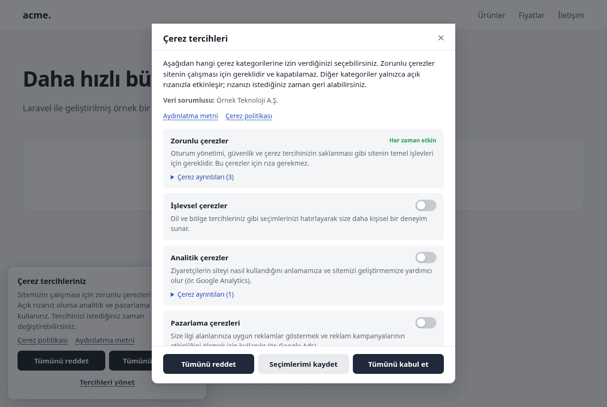
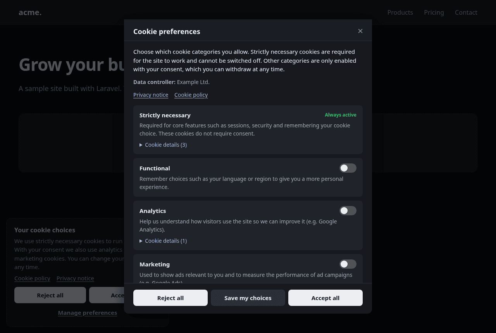
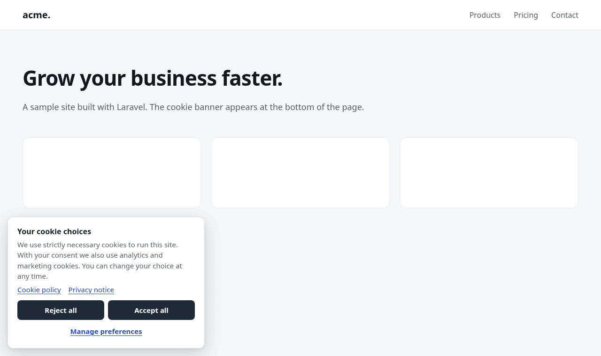
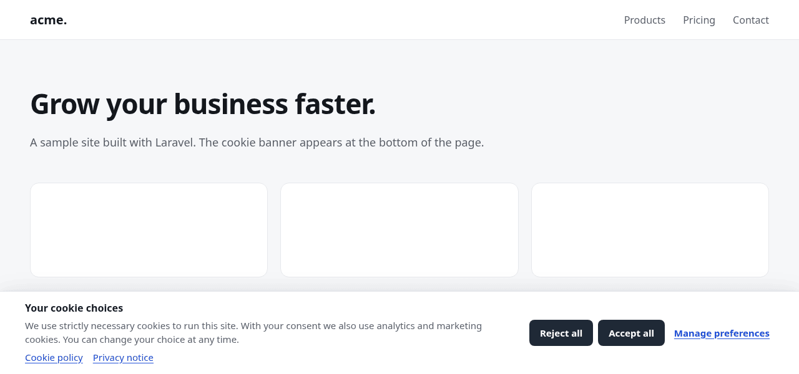
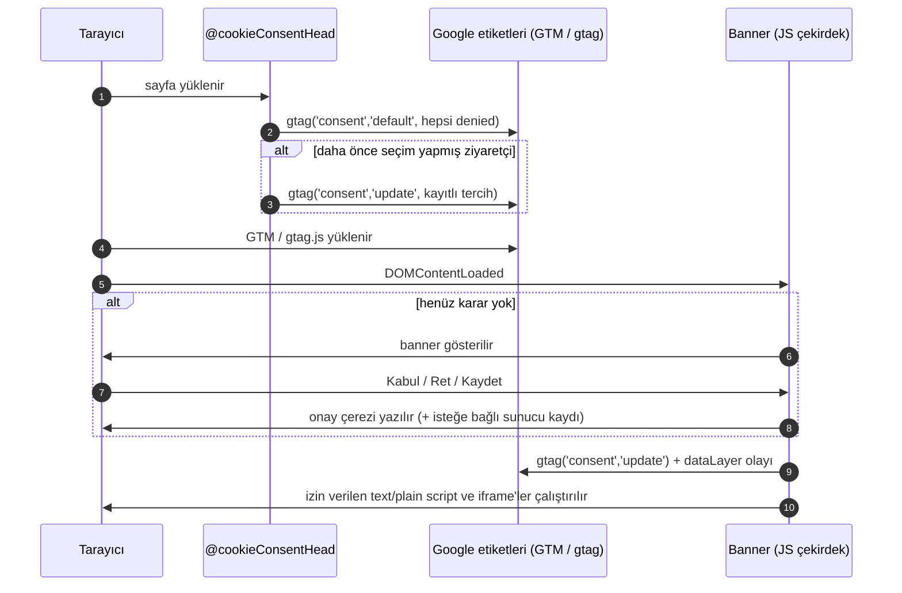

<div align="center">

# 🍪 Webmarka Cookie Consent

**Laravel 13+ için Google Consent Mode v2 destekli, KVKK / GDPR uyumlu çerez onay paketi.**

Bağımlılık yok, sunucuda Node.js gerekmez. Blade, Livewire, Inertia, Alpine.js ve Tailwind CSS ile çalışır.

[](https://github.com/hakanispirli/webmarka-cookie-consent/actions/workflows/tests.yml)
[](https://packagist.org/packages/webmarka/cookie-consent)
[](https://packagist.org/packages/webmarka/cookie-consent)
[](composer.json)
[](https://laravel.com)
[](LICENSE)

[**Kurulum**](#-kurulum) · [**Yapay zekâ ile kurulum**](#-yapay-zekâ-ile-kurulum) · [**Consent Mode v2**](#-google-consent-mode-v2) · [**KVKK**](#%EF%B8%8F-kvkk-kontrol-listesi) · [**English**](README.md)

<br>



</div>

---

## ✨ Özellikler

<table>
<tr>
<td width="50%" valign="top">

### 🎯 Google Consent Mode v2
- `ad_user_data` ve `ad_personalization` desteği
- Varsayılanlar Google etiketlerinden **önce** ayarlanır; daha önce seçim yapmış ziyaretçinin tercihi hemen geri yüklenir, sayfa görüntülemesi kaybolmaz
- **Advanced** ve **basic** mod, bölgeye özel varsayılanlar
- GTM tetikleyicileri için `dataLayer` olayı
- İsterseniz GTM ve gtag.js kodlarını doğru sırayla paket basar

</td>
<td width="50%" valign="top">

### ⚖️ KVKK / GDPR uyumlu varsayılanlar
- **"Tümünü reddet", "Tümünü kabul et" kadar görünür**
- Kutular önceden işaretli gelmez, banner'ı kapatmak onay sayılmaz
- Önce kısa bir banner, ardından kategori bazında seçim yapılan tercih merkezi
- Onay kolayca geri alınır ve ilgili çerezler silinir
- Veri sorumlusu, amaç, süre ve **yurt dışı aktarım** bilgisi gösterilir

</td>
</tr>
<tr>
<td valign="top">

### 🪶 Hafif ve her projeye uygun
- Gzip'li yaklaşık **4 KB** JavaScript, hiçbir bağımlılığı yok
- CSS değişkenleriyle tema (açık / koyu / otomatik)
- İsteğe bağlı **Alpine.js** store'u ve **Tailwind CSS** için stilsiz mod
- Livewire `wire:navigate`, Inertia ve Turbo ile çalışır

</td>
<td valign="top">

### 🧾 Rıza ispatı ve yönetim
- İsteğe bağlı olarak onaylar veritabanınıza kaydedilir
- IP anonimleştirilir, hash'lenir ya da hiç saklanmaz
- CSV dışa aktarma (Excel formül saldırısına karşı korumalı) ve eski kayıtları temizleme komutu
- Tam sayfa önbellek / CDN dostu, CSP nonce desteği
- Erişilebilir: odak tuzağı, klavye desteği, `prefers-reduced-motion`

</td>
</tr>
</table>

<details>
<summary><b>📸 Diğer ekran görüntüleri</b></summary>
<br>

| Mobil | Koyu tema |
|---|---|
|  |  |

| Kutu düzeni | Bar düzeni |
|---|---|
|  |  |

</details>

---

## 📋 İçindekiler

- [Gereksinimler](#-gereksinimler)
- [Kurulum](#-kurulum)
- [Yapay zekâ ile kurulum](#-yapay-zekâ-ile-kurulum)
- [Nasıl çalışır?](#-nasıl-çalışır)
- [Google Consent Mode v2](#-google-consent-mode-v2)
- [Script'leri onaya kadar engelleme](#-scriptleri-onaya-kadar-engelleme)
- [Yapılandırma](#%EF%B8%8F-yapılandırma)
- [KVKK kontrol listesi](#%EF%B8%8F-kvkk-kontrol-listesi)
- [Rıza kayıtları](#-rıza-kayıtları)
- [Frontend entegrasyonları](#-frontend-entegrasyonları)
- [JavaScript API](#-javascript-api)
- [Sunucu tarafı kontroller](#%EF%B8%8F-sunucu-tarafı-kontroller)
- [Görünümü özelleştirme](#-görünümü-özelleştirme)
- [Sık sorulan sorular](#-sık-sorulan-sorular)
- [Katkı](#-katkı) · [Güvenlik](#-güvenlik) · [Lisans](#-lisans)

---

## 📦 Gereksinimler

| | Sürüm |
|---|---|
| PHP | 8.3 veya üstü |
| Laravel | 13 veya üstü |
| Node.js | **Gerekmez.** Derlenmiş dosyalar pakette hazır gelir. |

## 🚀 Kurulum

**1. Paketi kurun:**

```bash
composer require webmarka/cookie-consent
php artisan cookie-consent:install
```

**2. Direktifleri layout dosyanıza ekleyin:**

```blade
<!DOCTYPE html>
<html lang="{{ str_replace('_', '-', app()->getLocale()) }}">
<head>
    <meta charset="utf-8">
    <meta name="viewport" content="width=device-width, initial-scale=1">
    <meta name="csrf-token" content="{{ csrf_token() }}">

    @cookieConsentHead {{-- ⚠️ EN BAŞTA: Google Tag Manager / gtag.js'den ÖNCE --}}

    {{-- GTM / gtag kodunuz (ya da paketin basmasına izin verin, aşağıya bakın) --}}
</head>
<body>
    {{ $slot }}

    <footer>
        <x-cookie-consent::preferences-button /> {{-- onayı istediği zaman değiştirme / geri alma --}}
    </footer>

    <x-cookie-consent::banner />
    @cookieConsentScripts
</body>
</html>
```

**3. Bilgilerinizi `.env` dosyasına yazın:**

```dotenv
COOKIE_CONSENT_CONTROLLER_NAME="Örnek Teknoloji A.Ş."
COOKIE_CONSENT_CONTROLLER_EMAIL=kvkk@ornek.com
COOKIE_CONSENT_PRIVACY_URL=/aydinlatma-metni
COOKIE_CONSENT_COOKIE_POLICY_URL=/cerez-politikasi

# İsteğe bağlı: Google etiketlerini paket doğru sırayla bassın
COOKIE_CONSENT_GTM_ID=GTM-XXXXXXX
COOKIE_CONSENT_GOOGLE_TAG_IDS=G-XXXXXXXXXX,AW-XXXXXXXXX
```

Hepsi bu kadar. 🎉 JS ve CSS dosyaları paketin kendi route'undan, içerik hash'i ve önbellekle sunulur. Asset publish etmeniz veya build almanız gerekmez.

> [!IMPORTANT]
> Sitenizin gerçekten kullandığı çerezleri `config/cookie-consent.php` dosyasında listeleyin. Bu çerezler tercih merkezinde ve çerez tablosunda gösterilir; onay geri alındığında da silinir.

---

## 🤖 Yapay zekâ ile kurulum

**Claude Code, Cursor, GitHub Copilot, ChatGPT, Codex veya Windsurf** mı kullanıyorsunuz? Aşağıdaki promptu kopyalayıp Laravel projeniz açıkken asistanınıza yapıştırın. Asistan projenizi inceler, paketi kurar, direktifleri doğru yere koyar, Google etiketlerinizi taşır, diğer takip kodlarını engeller ve şirket bilgilerinizi uydurmak yerine **size sorar**.

<details>
<summary><b>📋 Türkçe promptu kopyala</b></summary>

```text
Laravel projemde çalışıyorsun. Projeye `webmarka/cookie-consent` Composer paketini
(https://github.com/hakanispirli/webmarka-cookie-consent) entegre ederek KVKK / GDPR uyumlu,
Google Consent Mode v2 destekli bir çerez onay banner'ı ekle.

Dokümantasyon: Paketi kurduktan sonra `vendor/webmarka/cookie-consent/README.md` ve
`vendor/webmarka/cookie-consent/llms.txt` dosyalarını oku ve doğru bilgi kaynağı olarak bunları esas al.
Orada yazmayan direktif, config anahtarı veya API uydurma.

## Adım 1: İnceleme (sadece oku, henüz hiçbir şeyi değiştirme)
Kısaca raporla:
1. Laravel ve PHP sürümü. Paket Laravel 13+ ve PHP 8.3+ ister. Karşılanmıyorsa dur ve bana söyle.
2. <head> ve </body> içeren Blade layout dosyaları (layouts/*, components/layouts/*, Inertia için app.blade.php).
3. Tüm takip / üçüncü taraf kodları: Google Tag Manager, gtag.js / GA4, Google Ads, Meta Pixel, TikTok,
   LinkedIn Insight, Hotjar, Microsoft Clarity, Yandex Metrica, canlı destek widget'ları, YouTube / Google
   Maps embed'leri. Blade view'larında, JS dosyalarında, config'te ve .env'de ara.
4. Mevcut bir çerez banner'ı ya da gtag('consent', ...) çağrıları.
5. Frontend yapısı: Alpine.js, Tailwind CSS, Livewire, Inertia (Vue/React), Vite.
6. İçerik Güvenlik Politikası (CSP nonce) veya tam sayfa önbellek.
7. Sitenin kullandığı diller.

## Adım 2: Kurulum
    composer require webmarka/cookie-consent
    php artisan cookie-consent:install

## Adım 3: Layout
Her ana layout dosyasında:
- @cookieConsentHead: <head> içinde charset/viewport meta etiketlerinden sonra, tüm GTM / gtag.js kodlarından ÖNCE ilk öğe.
- </body> öncesine <x-cookie-consent::banner /> ve @cookieConsentScripts.
- Footer'a <x-cookie-consent::preferences-button />.
- Yoksa <meta name="csrf-token" content="{{ csrf_token() }}"> ekle.
- Alpine.js CDN'den yükleniyorsa @cookieConsentScripts direktifini <head> içinde Alpine'dan önce koy ve
  'assets' => ['alpine' => true] yap. Alpine Vite ile yükleniyorsa README'deki gibi plugin olarak kaydet.

## Adım 4: Google etiketleri
- Tercih edilen yol: ID'leri .env'ye taşı (COOKIE_CONSENT_GTM_ID, COOKIE_CONSENT_GOOGLE_TAG_IDS=G-...,AW-...)
  ve sabit yazılmış snippet'leri kaldır. Aksi halde snippet'leri @cookieConsentHead'den SONRA tut.
- GTM'in <noscript><iframe> yedeğini ve mevcut gtag('consent', ...) çağrılarını kaldır.

## Adım 5: Diğer üçüncü taraf kodları onaya kadar engelle
- <script> → <script type="text/plain" data-cc-category="analytics|marketing|functional"> (src ve diğer attribute'ları koru).
- <iframe src="..."> → <iframe data-cc-src="..." data-cc-category="...">.
- Sitenin çalışması için gereken kodları asla engelleme (uygulama bundle'ı, ödeme, CSRF, zorunlu captcha).

## Adım 6: Yapılandırma
Aşağıdaki değerleri BANA SOR. Şirket bilgisi veya URL uydurma:
    COOKIE_CONSENT_CONTROLLER_NAME=  COOKIE_CONSENT_CONTROLLER_EMAIL=
    COOKIE_CONSENT_PRIVACY_URL=      COOKIE_CONSENT_COOKIE_POLICY_URL=
config/cookie-consent.php içinde, Adım 1'de bulunan servislerin kullandığı her çerezi doğru kategoriye ekle
(name veya regex pattern, provider, purpose, duration, transfers_abroad ülke kodu veya null).

## Adım 7: İsteğe bağlı (önce bana sor)
Rıza kayıtları (cookie-consent:install --migrations, migrate, COOKIE_CONSENT_LOGGING=true, cookie-consent:prune
komutunu günlük zamanla); <x-cookie-consent::cookie-table /> ile çerez politikası sayfası; Tailwind ile stil;
Consent Mode için "advanced" yerine "basic".

## Adım 8: Doğrulama
php artisan optimize:clear ve testleri çalıştır. HTML çıktısında gtag('consent', 'default' satırının tüm
googletagmanager.com script'lerinden önce geldiğini doğrula. Bana tarayıcı kontrol listesi ver: gizli pencerede
banner görünüyor mu; seçimden önce _ga / _gcl_* / _fbp çerezi var mı; Kabul → "granted"; Ret → "denied";
footer butonu tercihleri açıyor mu.

## Kurallar
Küçük ve odaklı değişiklikler yap. Değişen tüm dosyaları ve benim elle yapmam gerekenleri listele. Bunun
hukuki danışmanlık olmadığını; metinlerin ve çerez listesinin bir hukukçuya kontrol ettirilmesi gerektiğini hatırlat.
```

</details>

📄 Promptun tamamı ve kısa sürümü [`docs/ai/install-prompt.tr.md`](docs/ai/install-prompt.tr.md) dosyasında. İngilizce prompt: [`docs/ai/install-prompt.en.md`](docs/ai/install-prompt.en.md).
🧠 Yapay zekâ ajanları paketle birlikte gelen [`llms.txt`](llms.txt) dosyasını okuyabilir. Bu dosya kısa bir API özeti içerir.

---

## 🧭 Nasıl çalışır?



---

## 🎯 Google Consent Mode v2

> [!NOTE]
> Google, **Mart 2024**'ten bu yana **AEA (Avrupa Ekonomik Alanı) ve Birleşik Krallık** trafiği alan reklamverenlerden onay sinyali istiyor. Sinyal gönderilmezse **Google Ads / GA4**'te remarketing, kitleler ve dönüşüm ölçümü kısıtlanıyor. **v2** ile `ad_user_data` ve `ad_personalization` sinyalleri eklendi.

| Kategori | Varsayılan | Consent Mode v2 türleri |
|---|---|---|
| `necessary` (zorunlu) | her zaman açık | `security_storage` |
| `functional` (işlevsel) | kapalı | `functionality_storage`, `personalization_storage` |
| `analytics` (analitik) | kapalı | `analytics_storage` |
| `marketing` (pazarlama) | kapalı | `ad_storage`, `ad_user_data`, `ad_personalization` |

Bu eşleme config'ten değiştirilebilir. Bir onay türü, onu kullanan **tüm** kategoriler onaylandığında `granted` olur.

### Advanced ve basic mod

| | `advanced` (varsayılan) | `basic` |
|---|---|---|
| Google etiketleri | hemen yüklenir, onay `denied` durumunda | ancak analitik **veya** pazarlama onayından sonra yüklenir |
| Onaydan önce | çerezsiz ping gönderilir | hiçbir şey gönderilmez |
| Dönüşüm modellemesi | reklamverene özel | genel |

```dotenv
COOKIE_CONSENT_GOOGLE_MODE=basic   # KVKK açısından daha temkinli seçenek
```

### GTM ipuçları

- GTM'de **izin genel bakışı**nı açın (*Yönetici → Container ayarları*). Google etiketleri Consent Mode'a otomatik uyar.
- Google dışı etiketler (Meta Pixel, Hotjar vb.) için `cookie_consent_update` adlı **Özel Etkinlik** tetikleyicisi kullanın ve `cookie_consent.marketing` Data Layer değişkeninin `true` olmasını koşul yapın.
- GTM'in `<noscript>` iframe'ini **kaldırın**. Onay olmadan yüklenir.

> [!TIP]
> **IAB TCF veya "Google sertifikalı CMP" gerekir mi?** Yalnızca AEA, Birleşik Krallık veya İsviçre'de **AdSense, Ad Manager veya AdMob** ile kişiselleştirilmiş reklam *gösteren* **yayıncılar** için gerekir. Google Ads ile reklam **veren** sitelere Consent Mode v2 yeterlidir. Bu paket de onu sağlar.

---

## 🛑 Script'leri onaya kadar engelleme

```html
<script type="text/plain" data-cc-category="analytics">/* analitik onayından sonra çalışır */</script>
<script type="text/plain" data-cc-category="marketing" src="https://connect.facebook.net/tr_TR/fbevents.js"></script>
<script type="text/plain" data-cc-category="analytics marketing" data-cc-require="any">/* ikisinden biri yeterli */</script>
<iframe data-cc-src="https://www.youtube-nocookie.com/embed/xyz" data-cc-category="marketing" hidden></iframe>
```

```blade
<x-cookie-consent::script category="analytics">
    // CSP nonce otomatik eklenir
</x-cookie-consent::script>
```

> [!NOTE]
> Bir kez çalışmış script geri alınamaz. Ziyaretçi daha önce verdiği bir onayı geri çektiğinde paket o kategorinin çerezlerini siler ve **sayfayı yeniler** (`ui.reload_on_withdraw`).

---

## ⚙️ Yapılandırma

```bash
php artisan vendor:publish --tag=cookie-consent-config
```

<details>
<summary><b>Tüm <code>.env</code> değişkenleri</b></summary>

| Değişken | Varsayılan | Açıklama |
|---|---|---|
| `COOKIE_CONSENT_ENABLED` | `true` | Paketi tamamen açar veya kapatır |
| `COOKIE_CONSENT_POLICY_VERSION` | `1` | Artırırsanız herkese yeniden sorulur |
| `COOKIE_CONSENT_CONTROLLER_NAME` | `APP_NAME` | Veri sorumlusu |
| `COOKIE_CONSENT_CONTROLLER_EMAIL` | – | İletişim e-postası |
| `COOKIE_CONSENT_CONTROLLER_ADDRESS` | – | Adres |
| `COOKIE_CONSENT_PRIVACY_URL` | – | Aydınlatma metni: URL, `/yol` veya `route:isim` |
| `COOKIE_CONSENT_COOKIE_POLICY_URL` | – | Çerez politikası |
| `COOKIE_CONSENT_GTM_ID` | – | GTM container'ını basar |
| `COOKIE_CONSENT_GOOGLE_TAG_IDS` | – | gtag.js'i basar: `G-XXXX,AW-XXXX` |
| `COOKIE_CONSENT_GOOGLE_MODE` | `advanced` | `advanced` veya `basic` |
| `COOKIE_CONSENT_LIFETIME` | `365` | Onay çerezinin ömrü (gün) |
| `COOKIE_CONSENT_DOMAIN` | – | Alt alan adlarında ortak onay için `.ornek.com` |
| `COOKIE_CONSENT_ASSETS` | `route` | `route` (publish gerekmez) veya `public` |
| `COOKIE_CONSENT_LOGGING` | `false` | Rıza kayıtlarını tutar |

</details>

<details>
<summary><b>Arayüz seçenekleri</b></summary>

| Anahtar | Varsayılan | Seçenekler |
|---|---|---|
| `ui.layout` | `box` | `box`, `bar`, `modal` |
| `ui.position` | `bottom-left` | `bottom-left`, `bottom-right`, `bottom`, `top` |
| `ui.theme` | `auto` | `auto`, `light`, `dark` |
| `ui.styles` | `true` | `false` yaparsanız paketin CSS'i yüklenmez (Tailwind / kendi stiliniz için) |
| `ui.show_close_button` | `false` | İsteğe bağlı çerezleri **reddeden** bir "X" butonu ekler |
| `ui.reload_on_withdraw` | `true` | Verilmiş bir onay geri alındığında sayfayı yeniler |

</details>

<details>
<summary><b>Yeni kategori veya çerez ekleme</b></summary>

```php
'categories' => [
    // ...
    'chat' => [
        'required' => false,
        'title' => 'Canlı destek',
        'description' => 'Destek ekibimizle yazışmanızı sağlar.',
        'consent_mode' => [],
        'cookies' => [
            [
                'name' => 'crisp-client',
                'pattern' => '^crisp-client',   // JS regex, onay geri alınınca silmek için
                'provider' => 'Crisp',
                'purpose' => 'Sohbet oturumunu sürdürür',
                'duration' => '6 ay',
                'transfers_abroad' => 'FR',     // KVKK md. 9: hedef ülke veya null
            ],
        ],
    ],
],
```

</details>

---

## ⚖️ KVKK kontrol listesi

<table>
<tr><th>✅ Paketin sağladıkları</th><th>📝 Sizin sorumluluğunuz</th></tr>
<tr>
<td valign="top">

- Onaydan önce isteğe bağlı çerez ve script **çalışmaz**
- Önceden işaretli kutu **yoktur**
- **Tümünü reddet = Tümünü kabul et** (aynı katman, aynı stil)
- Sayfayı kaydırmak, gezinmek veya banner'ı kapatmak onay **sayılmaz**
- Katmanlı yapı ve kategori bazında seçim
- Cookie wall **yoktur**
- Onay kolayca geri alınır, ilgili çerezler silinir
- Veri sorumlusu, amaç, süre, **yurt dışı aktarım** bilgisi
- Politika değişince ve süre dolunca yeniden onay istenir
- İsteğe bağlı **rıza kaydı**

</td>
<td valign="top">

- Sitenizin kullandığı tüm çerezleri listeleyin
- Aydınlatma metnini rıza metninden **ayrı** yayınlayın
- Çerez politikası sayfası hazırlayın (`<x-cookie-consent::cookie-table />`)
- Yurt dışı aktarımın hukuki dayanağını kontrol edin (KVKK md. 9, 12.03.2024 değişikliği)
- Metinlerinizi bir hukukçuya kontrol ettirin

</td>
</tr>
</table>

Kaynaklar: [KVKK Çerez Uygulamaları Rehberi](https://kvkk.gov.tr/Icerik/7353/Cerez-Uygulamalari-Hakkinda-Rehber) · [KVKK Yurt Dışına Aktarım](https://www.kvkk.gov.tr/Icerik/2053/Yurtdisina-Aktarim) · [Google: AEA consent mode güncellemesi](https://support.google.com/google-ads/answer/13695607)

> [!CAUTION]
> Bu paket teknik bir araçtır, **hukuki danışmanlık değildir**. Çerez listesi, metinler ve hukuki dayanaklar veri sorumlusu olarak sizin sorumluluğunuzdadır.

---

## 🧾 Rıza kayıtları

KVKK'ya göre rızanın alındığını ispat etmek veri sorumlusuna düşer. İsteğe bağlı kayıt özelliğini açmak için:

```bash
php artisan cookie-consent:install --migrations
php artisan migrate
```

```dotenv
COOKIE_CONSENT_LOGGING=true
```

Her karar `POST /cookie-consent` adresine gönderilir (`web` middleware'i ve istek sınırlaması ile) ve şunlarla birlikte kaydedilir:

- **onay ID'si** (ziyaretçinin çerezinde de saklanır)
- yapılan işlem, kategoriler, Consent Mode durumları ve politika sürümü
- dil, URL ve tarayıcı bilgisi (user agent)
- ziyaretçi giriş yapmışsa kullanıcı ID'si
- varsayılan olarak **anonimleştirilmiş** IP adresi (`logging.ip`: `none` · `anonymize` · `hash` · `full`)

```bash
php artisan cookie-consent:export storage/app/rizalar.csv --from=2026-01-01 --to=2026-12-31
php artisan cookie-consent:export --consent-id=6f1c1b7e-...
php artisan cookie-consent:prune   # logging.retention_days süresinden (varsayılan 3 yıl) eski kayıtları siler
```

```php
// routes/console.php
use Illuminate\Support\Facades\Schedule;

Schedule::command('cookie-consent:prune')->daily();
```

---

## 🧩 Frontend entegrasyonları

<details open>
<summary><b>Düz Blade / Bootstrap / diğerleri</b></summary>

Ek bir ayar gerekmez. Paketin CSS'i `cc-` önekiyle sınırlandırılmıştır, sizin stillerinizle çakışmaz.

</details>

<details>
<summary><b>Tailwind CSS</b></summary>

Config'te `'ui' => ['styles' => false]` yapın ve view'ları publish edin:

```bash
php artisan vendor:publish --tag=cookie-consent-views
```

View'ları kendi Tailwind sınıflarınızla düzenleyin. JavaScript bunlara dayandığı için **`data-cc-*` attribute'larını silmeyin**. Tailwind v4 kullanıyorsanız CSS dosyanıza `@source "../views/vendor/cookie-consent";` satırını ekleyin.

</details>

<details>
<summary><b>Alpine.js</b></summary>

```js
// resources/js/app.js (Vite)
import Alpine from 'alpinejs';
import cookieConsent from '../../vendor/webmarka/cookie-consent/dist/cookie-consent-alpine.esm.js';

Alpine.plugin(cookieConsent);
Alpine.start();
```

**CDN** kullanıyorsanız `'assets' => ['alpine' => true]` yapın ve `@cookieConsentScripts` direktifini `<head>` içinde Alpine script'inden **önce** koyun.

```blade
<div x-data>
    <template x-if="!$store.cookieConsent.has('marketing')">
        <button @click="$store.cookieConsent.showPreferences()">Videoyu izlemek için pazarlama çerezlerine izin verin</button>
    </template>
</div>
```

</details>

<details>
<summary><b>Livewire · Inertia · Turbo</b></summary>

JS çekirdeği event delegation kullanır ve `livewire:navigated`, `turbo:load`, `inertia:navigate` olaylarında sayfayı yeniden kontrol eder. Inertia'da direktifleri ve banner bileşenini kök `app.blade.php` dosyasına ekleyin.

</details>

---

## 🧪 JavaScript API

```js
CookieConsent.hasConsent('analytics');  // boolean
CookieConsent.hasDecided();             // boolean
CookieConsent.getState();               // { v, id, pv, c: {...}, ts } | null
CookieConsent.acceptAll();
CookieConsent.rejectAll();
CookieConsent.save({ analytics: true, marketing: false });
CookieConsent.showPreferences();
CookieConsent.reset();                  // kararı unut ve yeniden sor

CookieConsent.on('cookie-consent:updated', ({ state, previous, action, withdrawn }) => { /* ... */ });
```

`data-cc-action="show-preferences"` (veya `accept-all`, `reject-all`, `save`) attribute'u olan her öğe çalışır. Örneğin çerez politikası sayfanızdaki bir link.

---

## 🖥️ Sunucu tarafı kontroller

```blade
@consent('marketing')
    <x-pazarlama-pikseli />
@endconsent
```

```php
use Webmarka\CookieConsent\Facades\CookieConsent;

CookieConsent::granted('analytics');
```

> [!WARNING]
> Sunucu tarafı kontroller onay çerezini istekten okur. Bu yüzden **tam sayfa önbellek** (Cloudflare, Varnish, response cache) ile sunulan sayfalarda kullanmayın. Bu sayfalarda [script engelleme](#-scriptleri-onaya-kadar-engelleme) yöntemini kullanın.

---

## 🎨 Görünümü özelleştirme

| Ne | Nasıl |
|---|---|
| Metinler | `php artisan vendor:publish --tag=cookie-consent-lang` |
| HTML yapısı | `php artisan vendor:publish --tag=cookie-consent-views` |
| Renk, font, köşe yuvarlaklığı | CSS değişkenleri |
| Sayfaya özel düzen | `<x-cookie-consent::banner layout="bar" position="top" theme="dark" />` |

```css
.cc-root {
    --cc-primary: #0f766e;
    --cc-radius: 6px;
    --cc-btn-radius: 999px;
}
```

---

## ❓ Sık sorulan sorular

<details>
<summary><b>Sunucumda Node.js gerekir mi?</b></summary>

Hayır. Derlenmiş JS ve CSS paketle birlikte gelir ve bir Laravel route'u üzerinden sunulur. TypeScript kaynak dosyaları ve testler Composer paketine dahil edilmez.

</details>

<details>
<summary><b>Banner herkese mi gösterilir?</b></summary>

Evet. KVKK Türk sitelerinin tüm ziyaretçileri için geçerlidir; bu yüzden banner'ı herkese göstermek güvenli varsayılandır. Bazı bölgelerde yalnızca Google varsayılanlarını gevşetmek isterseniz `region_defaults` kullanın.

</details>

<details>
<summary><b>Herkese yeniden onay sormak için ne yapmalıyım?</b></summary>

`COOKIE_CONSENT_POLICY_VERSION` değerini artırın.

</details>

<details>
<summary><b>Paket dış bir servise bağlanıyor mu?</b></summary>

Hayır. Her şey kendi sunucunuzda çalışır. Google etiketleri yalnızca siz yapılandırırsanız yüklenir.

</details>

---

## 🤝 Katkı

Katkılarınızı bekliyoruz! [CONTRIBUTING.md](CONTRIBUTING.md) ve [Davranış Kuralları](CODE_OF_CONDUCT.md) dosyalarını okuyun. Yeni dil çevirileri özellikle değerli.

## 🔒 Güvenlik

Güvenlik açıklarını lütfen **gizli** olarak bildirin. Ayrıntılar için [SECURITY.md](SECURITY.md) dosyasına bakın.

## 📄 Lisans

[MIT Lisansı](LICENSE) ile yayınlanmıştır. Telif hakkı © 2026 Webmarka.

Yazılımı telif hakkı ve lisans bildirimini koruduğunuz sürece ticari projeler dahil serbestçe kullanabilir, kopyalayabilir, değiştirebilir ve dağıtabilirsiniz. `dist/` altındaki derlenmiş dosyaların başında bu bildirim yer alır. Yazılım **"olduğu gibi", hiçbir garanti olmaksızın** sunulur.

<div align="center">
<br>
Türkiye'de ❤️ ile geliştirildi · <a href="https://github.com/hakanispirli">Webmarka</a> · İşinize yaradıysa repoya ⭐ vermeyi unutmayın!
</div>
