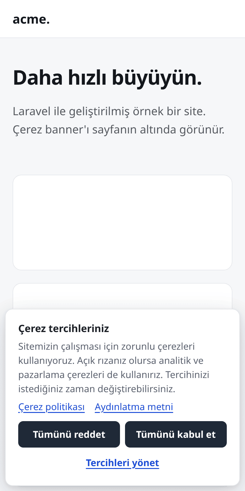

# Webmarka Cookie Consent

[](https://github.com/hakanispirli/webmarka-cookie-consent/actions/workflows/tests.yml)
[](https://packagist.org/packages/webmarka/cookie-consent)
[](LICENSE)

[English](README.md)

Laravel 13+ için **Google Consent Mode v2** destekli, **KVKK / GDPR** uyumlu çerez onay paketi.



## Ne işe yarar?

- Sitenizde çerez banner'ı ve tercih merkezi gösterir (zorunlu, işlevsel, analitik, pazarlama).
- Google'a onay sinyallerini gönderir (`ad_storage`, `analytics_storage`, `ad_user_data`, `ad_personalization`).
- Analitik ve pazarlama script'lerini ziyaretçi onay verene kadar çalıştırmaz.
- İsterseniz her onayı rıza ispatı için veritabanına kaydeder.

## Ne fayda sağlar?

- **Google Ads özelliklerini korursunuz.** Google, AB ve Birleşik Krallık trafiği için Consent Mode v2 istiyor. Olmazsa remarketing ve dönüşüm ölçümü kısıtlanıyor.
- **KVKK / GDPR uyumlu varsayılanlar.** "Tümünü reddet" butonu "Tümünü kabul et" kadar görünür. Kutular önceden işaretli gelmez, banner'ı kapatmak onay sayılmaz, onay her zaman geri alınabilir.
- **Kolay kurulum.** Sunucuda Node.js ya da build adımı gerekmez. Blade, Livewire, Inertia, Alpine.js, Tailwind CSS ve Bootstrap ile çalışır.
- **Hafif ve bağımsız.** Yaklaşık 4 KB JavaScript, dış servise bağlantı yok.

## Nasıl çalışır?

1. `@cookieConsentHead` direktifi `<head>` içinde ilk sırada çalışır ve tüm Google onay türlerini `denied` yapar. Daha önce seçim yapmış bir ziyaretçinin tercihini hemen geri yükler.
2. İlk kez gelen ziyaretçiye banner gösterilir. Seçimi birinci taraf bir çerezde saklanır.
3. Seçimden sonra Google'a `consent update` gönderilir ve izin verilen kategorilerdeki engelli script'ler (`type="text/plain"`) çalıştırılır.

## Kurulum

```bash
composer require webmarka/cookie-consent
php artisan cookie-consent:install
```

Layout dosyanıza ekleyin:

```blade
<head>
    @cookieConsentHead   {{-- en başta, Google Tag Manager / gtag.js'den önce --}}
</head>
<body>
    ...
    <x-cookie-consent::preferences-button />   {{-- örn. footer'da --}}
    <x-cookie-consent::banner />
    @cookieConsentScripts
</body>
```

`.env` dosyasına bilgilerinizi yazın:

```dotenv
COOKIE_CONSENT_CONTROLLER_NAME="Örnek Teknoloji A.Ş."
COOKIE_CONSENT_PRIVACY_URL=/aydinlatma-metni
COOKIE_CONSENT_COOKIE_POLICY_URL=/cerez-politikasi

# isteğe bağlı: Google etiketlerini paket doğru sırayla basar
COOKIE_CONSENT_GTM_ID=GTM-XXXXXXX
COOKIE_CONSENT_GOOGLE_TAG_IDS=G-XXXXXXXXXX,AW-XXXXXXXXX
```

## Diğer script'leri engelleme

```html
<script type="text/plain" data-cc-category="analytics" src="https://example.com/analytics.js"></script>
<script type="text/plain" data-cc-category="marketing">/* Meta Pixel, TikTok vb. */</script>
<iframe data-cc-src="https://www.youtube-nocookie.com/embed/xyz" data-cc-category="marketing"></iframe>
```

Blade'de `@consent('marketing') ... @endconsent`, JavaScript'te `CookieConsent.hasConsent('analytics')` kullanabilirsiniz.

## Yapılandırma

Kategoriler, çerez listesi, görünüm (`box`, `bar`, `modal`), tema, Consent Mode modu (`advanced` / `basic`) ve rıza kayıtları `config/cookie-consent.php` dosyasından ayarlanır. Sitenizin kullandığı çerezleri burada listeleyin. Bu çerezler ziyaretçiye gösterilir ve onay geri alındığında silinir.

Rıza kayıtları (isteğe bağlı):

```bash
php artisan cookie-consent:install --migrations && php artisan migrate
# .env: COOKIE_CONSENT_LOGGING=true
php artisan cookie-consent:export rizalar.csv
```

Metinleri veya HTML yapısını değiştirmek için `--tag=cookie-consent-lang` ya da `--tag=cookie-consent-views` ile publish edin. Tailwind kullanıyorsanız `ui.styles` değerini `false` yapıp publish ettiğiniz view'ları kendi sınıflarınızla düzenleyin.

## Yapay zekâ ile kurulum

Hazır promptu Claude Code, Cursor, Copilot veya ChatGPT'ye yapıştırın; asistan paketi projenize entegre etsin: [Türkçe prompt](docs/ai/install-prompt.tr.md) · [İngilizce prompt](docs/ai/install-prompt.en.md). Yapay zekâ araçları için kısa bir API özeti de var: [`llms.txt`](llms.txt).

## Notlar

- Consent Mode v2, Google Ads ile reklam **veren** siteler içindir. AdSense, Ad Manager veya AdMob ile reklam **gösteren** yayıncıların ise Google sertifikalı bir CMP (IAB TCF) kullanması gerekir.
- Bu paket teknik bir araçtır, hukuki danışmanlık değildir. Çerez listenizi ve metinlerinizi bir hukukçuya kontrol ettirin.

## Lisans

[MIT](LICENSE). Katkılarınızı bekliyoruz: [CONTRIBUTING.md](CONTRIBUTING.md). Güvenlik açıklarını [SECURITY.md](SECURITY.md) dosyasındaki yöntemle bildirin.

---

Geliştiren: [webmarka.com](https://webmarka.com/?ref=github-cookie-consent)
